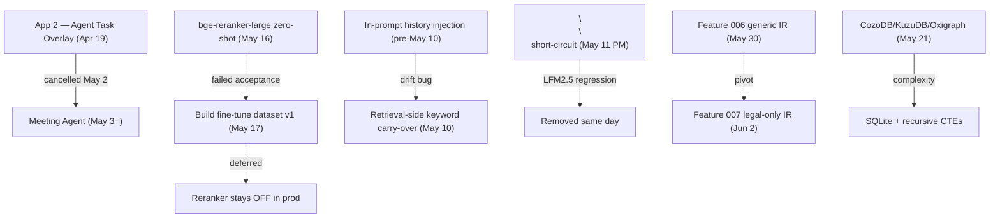

# EchoAI — Project Decision History

> A chronological, decision-level record of what we tried, what we rejected,
> what we integrated, and **why** — across the whole project (Apr 2026 → Jun 2026).
>
> **Spine sources** (authoritative): `CHANGELOG_DEV.md`, `history/adr/`,
> `history/prompts/`, `git log --all`. This doc is the synthesized view.
>
> **Legend**: ✅ Integrated · ❌ Rejected · 🔄 Reverted/Replaced · 🧪 Experiment-only · ⏸ Deferred

---

## 0. Big-picture timeline

```mermaid
timeline
    title EchoAI — phase arcs
    section Foundation (Apr 13–24)
        ADR-0001..0006 : LLM hosting, embeddings, voice, sandbox
        Scheduler + workload bar : cooperative pause + cancel tokens
    section App 1 — Notebook Knowledge Engine (Apr 24–26)
        Feature 001 merge : streaming chat + Keep/Discard + analyze
        Trial lock (7d → 30d) : offline activation
    section App 2 — Agent Overlay (Apr 19–May 2)
        ADR-0003..0006 designed : ReAct + voice + Wasmtime
        CANCELLED : replaced by Meeting Agent
    section Meeting Agent (May 3–4)
        Phase 1+2 : whisper sidecar + cpal/VAD/rubato
    section Speed audit + cloud (May 2)
        Reviewer judge OFF : was nuking good answers
        Groq toggle ON : local vs cloud A/B
    section Benchmark + prompt iteration (May 9–12)
        10×17 sweep : Qwen2.5-1.5B vs Qwen3-1.7B vs Llama-3.2-3B
        Prompt v4.1 → v5.2 : think-leaks, citation drift, history-leak
    section Tier 3 hierarchical (May 15–16)
        Multi-level chunker + reranker + grounding
    section Reranker fine-tune (May 16–18)
        Zero-shot bge-reranker-large : FAILED acceptance
        Build dataset v1 : Colab T4 fine-tune planned
    section Feature 003 — Constitution v1 (May 21–24)
        ADR-0007 hierarchy+graph : SQLite (no graph engine)
        S1..S7 + Idea 1+2 : 5-stack post-RRF boost
    section Feature 004 — OCR (May 24)
        3-tier extraction : lopdf → pdftotext → tesseract
    section Feature 005 — Structured importer (May 24–29)
        V5 forensic audit + 22-prompt eval : 5 retrieval fixes
    section Feature 006 — LLM PDF→JSON (May 29 – Jun 2)
        Mistral-7B + llguidance : grammar-constrained IR
        8 rounds : GGUF, prompts, dispatch, parse — green
    section Investor demo (Jun 2–3)
        Groq 70B K=20 : 80% OK / 1.61s / 0 hallucinations
    section Feature 007 — Legal RAG Pakistan (Jun 2–3)
        Hard pivot to legal : constitution v1.1.0 (§IX–§XIII)
        Phase 3 MVP MERGED : 85% OK / 0% WRONG, Cerebras 120B
```

---

## 1. Foundation (Apr 13–24, 2026)

| Date | Decision | Status | Why |
|---|---|---|---|
| 2026-04-13 | **ADR-0001**: In-process `ModelSlot` for Tier-3/4 LLMs; sidecar reserved for vision only | ✅ Integrated | Embed in Tauri Rust → no IPC overhead for hot path; sidecar only where crash isolation justifies it. Reversing this later requires removing a service boundary. |
| 2026-04-13 | **ADR-0002**: `nomic-embed-text-v1.5` 768d primary; `all-MiniLM-L6-v2` 384d fallback | ✅ Integrated | sqlite-vec `FLOAT[N]` schema is fixed at table creation — choosing wrong = hours of re-index. Hardware-detected at first launch and pinned in `db_config`. |
| 2026-04-19 | **ADR-0003**: Single Tauri process, two windows (Notebook + Overlay) — *not* multi-process | ✅ Integrated | One ModelSlot in shared `Arc<Mutex<…>>`; constitution §III bans two LLMs resident. Multi-process would double RAM. |
| 2026-04-19 | **ADR-0004**: ReAct loop driven by TOML persona configs (no hardcoded prompts) | ✅ Integrated | Adding a tool = config change, not code change. Safety classes (READ_ONLY / CAUTIOUS / DANGEROUS) declared in TOML. |
| 2026-04-19 | **ADR-0005**: Silero VAD + whisper-rs wake-word + Kokoro TTS pipeline | ✅ Integrated | Continuous VAD avoids burning CPU on whisper; wake-word via small audio buffer keeps latency <1s offline. |
| 2026-04-19 | **ADR-0006**: Wasmtime/WASI for JS; restricted subprocess for Python/Bash | ✅ Integrated | True WASM sandbox only practical for JS in 2026. Python/Bash need real interpreters → subprocess with resource limits. |
| 2026-04-24 | Cooperative scheduler with priority pause + cancel tokens | ✅ Integrated | File-watcher / NER / KG must yield to Chat. Strict `>` priority comparison so peers don't preempt each other. |
| 2026-04-24 | Per-file transaction in indexer + orphan-job reconcile on startup | ✅ Integrated | Crashes mid-index used to corrupt rows. Reconcile flips `processing → pending` on boot. |

## 2. App 1 — Notebook Knowledge Engine (Apr 24–26, 2026)

| Date | Decision | Status | Why |
|---|---|---|---|
| 2026-04-25 | Streaming chat bubble with Stop/Send morph + Keep/Discard modal + thinking narrative | ✅ Integrated | UX requirement: user must see token-by-token output and be able to cancel mid-flight without losing the partial. |
| 2026-04-26 | Foreground-priority scheduler + `chat://background-paused` event | ✅ Integrated | Chat preempts batch / NER / file watcher. Workload bar shows current job + ETA. |
| 2026-04-26 | Sequential indexing (not parallel) + WAL + busy_timeout 90s | ✅ Integrated | Parallel writers caused SQLite contention on a single-file DB. Sequential + WAL is the right shape for desktop. |
| 2026-04-26 | Grounding prompt v2.5.0 + citation placeholder fix + startup model warmup | ✅ Integrated | Cold sqlite-vec init was 40s on first query; warmup hides it. |
| 2026-04-26 | `MAX_PROMPT_TOKENS` 768→928, `CONTEXT_TOKEN_BUDGET` 768→640 | ✅ Integrated | Trace showed budget filled on first chunk; need room for prompt + 3 chunks. |
| 2026-04-28 | Cross-platform fastembed cache path + GitHub Actions Windows build | ✅ Integrated | Trial users on Windows need same first-run experience as Linux. |
| 2026-04-28 | Offline 7-day trial lock; later extended to 30 days | ✅ → 🔄 Extended | First version was too short for an enterprise eval cycle. |
| 2026-04-26 | Feature 001 merged to master (`bad2b831`) | ✅ Integrated | App 1 baseline shipped. |

## 3. App 2 — Agent Task Overlay (Apr 19 – May 2)

| Date | Decision | Status | Why |
|---|---|---|---|
| 2026-04-19 | Full design (ADRs 0003–0006) for hands-free voice-driven agent | 🧪 Designed only | All four ADRs are still "Accepted" but the product direction shifted. |
| 2026-05-02 | App 2 **cancelled**; replaced by Meeting Agent | ❌ Rejected | Hands-free agent overlay solved a niche; meeting-capture solved a daily-use need. Reuses VAD + whisper-rs from ADR-0005. |

## 4. Meeting Agent (May 3–4, 2026)

| Date | Decision | Status | Why |
|---|---|---|---|
| 2026-05-03 | **STT in a sidecar process** (not in-process) | ✅ Integrated | `whisper-rs` and `llama-cpp-2` both bundle ggml under the same C symbol names — in-process linker collision. Sidecar isolates symbols and any whisper crash. |
| 2026-05-03 | NDJSON-over-stdio protocol (`load` / `transcribe` / `transcribe_b64` / `shutdown`) | ✅ Integrated | Simple, debuggable, no dependency on tonic/grpc. |
| 2026-05-04 | cpal capture → rubato resample 16kHz → webrtc-vad segmenter → whisper sidecar → SQLite | ✅ Integrated | Each component is the smallest crate that does its job offline; no FFmpeg dependency. |
| 2026-05-04 | `cpal::Stream` + `webrtc_vad::Vad` live in `spawn_blocking` threads (they're `!Send`) | ✅ Integrated | `ActiveMeeting` holds a `oneshot` shutdown sender + `JoinHandle` instead of the Stream directly. |
| 2026-05-04 | Single active meeting at a time (no concurrency) | ✅ Integrated | YAGNI for v1. Phase 3 concern. |

## 5. Speed audit & cloud inference (May 2, 2026)

| Date | Decision | Status | Why |
|---|---|---|---|
| 2026-05-02 | **Reviewer judge OFF by default** (gated by `ECHO_REVIEWER=1`) | ❌ Rejected as default | Context-blind judge at n_ctx=512 had ~25% false-negative rate → 3 retries × 30–60s each. Was killing good answers. |
| 2026-05-02 | Step-by-step `query_trace.rs` (`.log` per query + rolling `queries.jsonl`) | ✅ Integrated | Without a human-readable trace, every benchmark required pasting the chat window manually. |
| 2026-05-02 | Auto-detect physical threads (`logical/2`, floor 4, cap 8) for llama.cpp | ✅ Integrated | Was hardcoded to 4 → 1.6× decode on 16-core. `ECHO_LLM_THREADS=N` overrides. |
| 2026-05-02 | 1.5B fast-model option via `ECHO_FAST_MODEL=1` | ✅ Integrated | 2× decode vs 3B on CPU; quality tradeoff is per-user. |
| 2026-05-02 | Cloud inference (Groq) toggle | ✅ Integrated (off by default) | Privacy tradeoff. Local CPU: 3.4 tok/s; Groq Llama-3.1-8B: ~270 tok/s. |
| 2026-05-02 | Cloud routing scoped to **Chat / NER / Analyze / Batch only** — NOT indexing | ✅ Integrated | Embedding is not an LLM op; cloud won't speed indexing. |
| 2026-05-02 | Loosen grounding fallback (don't nuke long answers missing citations) | ✅ Integrated | 3B models produce correct answers without `[file p.N]` markers; fallback was deleting good content. Attach `QualityNotice` instead. |
| 2026-05-02 | Raise context K from 1 → 3 chunks | ✅ Integrated | Trace showed budget filled on first chunk; multi-chunk lets model corroborate. |

## 6. Benchmark + prompt iteration (May 9–12, 2026)

| Date | Decision | Status | Why |
|---|---|---|---|
| 2026-05-09 | 10-model × 17-prompt benchmark framework (Sindh civil-service corpus) | ✅ Integrated | Empirical answer required for "which offline model on i5-6300U". |
| 2026-05-09 | Repetition `last_n` 64 → 256; `GROUNDING_PROMPT` worked example removed | ✅ Integrated | Qwen2.5-1.5B v1 emitted multi-sentence loops on P2/P5/P10/P15. v2 avg time 112.6s → 62.4s (−45%); accuracy 1.33 → 1.60. |
| 2026-05-10 | **Drop in-prompt conversation history entirely** | 🔄 Reverted | 150-char truncation sliced mid-sentence → 1.5B-3B models treated truncated prior assistant turn as a few-shot example and copied the opener. Cross-prompt drift. |
| 2026-05-10 | Chat memory via **retrieval-side keyword carry-over** (option #2) | ✅ Integrated | Replaces in-prompt history. Extracts ≤5 keywords from prior user turns, appends to embed + FTS5 query. Prompt stays history-free. |
| 2026-05-10 | UTF-8 byte-slicing → `chars().take(N)` everywhere | ✅ Integrated | Llama-3.2-3B P13 (Urdu) panicked: `byte index 300 is not a char boundary`. Class-of-bug fix across 5 sites. |
| 2026-05-11 | Qwen3-1.7B sweep | ❌ Rejected | Lost to Qwen2.5-1.5B despite better calibration. `<think>` leaks burned 250+ tokens; pseudo-XML citation format; 40s cold sqlite-vec. |
| 2026-05-11 | 6-fix batch: strip `<think>`, loosen citation extractor, warm sqlite-vec, follow-up-only history, language pin, kill XML placeholders (prompt v4.2.0) | ✅ Integrated | Each fix targets a measured Qwen3 failure in trace. |
| 2026-05-11 (PM) | `<think>\n\n</think>\n\n` short-circuit injected after assistant turn opener | ✅ → 🔄 Reverted | Doc-recipe optimisation; backfired on LFM2.5 (skipped reasoning on procedural prompts). Removed late same day. |
| 2026-05-11 | Streaming `<think>` filter in `infer_with_cancel` (32-byte tail) | ✅ Integrated | Belt-and-suspenders even if model ignores short-circuit. UI never sees raw CoT. |
| 2026-05-11 | Warmup uses real `embed_one("civil servant rules procedure")` vector (not zeros) | ✅ Integrated | Zero-vector warmup paid v-table init but P3 still cold at 56s. Real vector pre-warms the page topology. |
| 2026-05-11 (night) | Prompt v5.1.0 + `PART 1 — ANSWER:` anchor + post-hoc CoT scrubber | ✅ Integrated | v5.0 was 2077 tokens, truncated at 1800 → silent-reasoning directive cut off. 1.2B thinking models unreliable about `<think>` tags. |
| 2026-05-11 | Corpus dedup: 61 → 44 sources (17 byte-identical dupes deleted) | ✅ Integrated | Inflated recall + wasted context budget. |
| 2026-05-12 | Prompt v5.2.0 (instruct-only, `[N]` citations) + Summary budget fix | ✅ Integrated | Thinking-model anchor superseded since user dropped thinking models. |

## 7. Tier 3 hierarchical retrieval (May 15–16, 2026)

| Date | Decision | Status | Why |
|---|---|---|---|
| 2026-05-15 | Hierarchical chunk schema (migration 013) + extend `NewChunk` with hierarchy fields | ✅ Integrated | Flat chunks couldn't disambiguate "Article 69" — same label spanned ~60 articles. |
| 2026-05-16 | Heading detection: regex Pass A + LLM Pass B disambiguation with bounded budget | ✅ Integrated | Regex catches legal/numbered/notification; LLM cleans the rest within a fixed budget. |
| 2026-05-16 | Document tree builder (document → section → leaf) | ✅ Integrated | Tier 3 needs the tree to support sibling rollup + small-to-big expansion. |
| 2026-05-16 | bge-reranker-base ONNX cross-encoder | ✅ Integrated | Hybrid BM25/FTS5 ⊕ vector RRF → reranker → top-K. |
| 2026-05-16 | Sentence-level Jaccard grounding validator | ✅ Integrated | Per-sentence strip/retry instead of per-answer fail/refuse. |

## 8. Reranker fine-tune attempt (May 16–18, 2026)

| Date | Decision | Status | Why |
|---|---|---|---|
| 2026-05-16 (night) | bge-reranker-large **zero-shot** swap | ❌ Rejected | Failed acceptance on the Sindh corpus. Larger zero-shot reranker no better than base on domain-specific text. |
| 2026-05-16 (night) | `ECHO_RERANKER_MODEL` env switch | ✅ Integrated | Lets us A/B without recompiling. |
| 2026-05-18 | Reranker A/B with Groq Llama-70B + RAGAS scoring + prompt/truncation knob tuning | ❌ Concluded futile | Zero-shot reranker is **domain-blind**; prompt and truncation knobs don't move the needle. |
| 2026-05-17 | **Verdict: fine-tune is the only path** — built dataset v1 (198 train / 23 eval BGE triples) at `data/reranker/v1/` | ⏸ Deferred | Colab T4 fine-tune queued; reranker stayed **hardcoded OFF** in production until then. |

## 9. Embedder + linker fixes (May 20, 2026)

| Date | Decision | Status | Why |
|---|---|---|---|
| 2026-05-20 | Force GNU `bfd` linker | ✅ Integrated | The ntfs3 driver broke `mold` / `lld` link steps. |
| 2026-05-20 | Fix fastembed: ORT version + libonnxruntime symlink stubs | ✅ Integrated | Embedder verified: 768-d vectors, no NaN/Inf, deterministic across runs. |

## 10. Feature 003 — Constitution v1 (May 21–24, 2026)

| Date | Decision | Status | Why |
|---|---|---|---|
| 2026-05-21 | **ADR-0007**: Profile-driven hierarchical + graph document model | ✅ Integrated | Tier 3 baseline produced 1 doc / 11 sections / 253 leaves with 6 labels eating 93% of leaves (e.g. "Article 69" = 48 leaves). Wrong citations, reranker can't disambiguate. |
| 2026-05-21 | **No dedicated graph engine** (CozoDB / KuzuDB / Oxigraph rejected) | ❌ Rejected | SQLite `graph_nodes` + typed `graph_edges` + bounded recursive CTEs is sufficient for 1-hop expansion. One DB, one process. |
| 2026-05-21 | Doc-type profile system (constitution first, Act / Rules later) | ✅ Integrated | Parser parametrized by profile = generalizable across legal corpus. |
| 2026-05-21 | Leaf granularity = **sub-clause** with article heading + clause chapeau prepended | ✅ Integrated | Provisos/explanations kept attached to the rule they modify. |
| 2026-05-21 | Source acquisition: clean structured HTML (pakistani.org) where available; OCR otherwise | ✅ Integrated | Constitution available as clean HTML → bypass OCR entirely for v1. |
| 2026-05-22 | S2 doc-profile + structure parser + S3 tree persistence + S4 graph builder | ✅ Integrated | Sliced delivery to keep merges small. |
| 2026-05-22 | S5 multi-level embedding + indexer wiring; A2/A3 PASS | ✅ Integrated | End-to-end acceptance gate `cargo test --test constitution_v1_acceptance` (5/5, 1.65s, no LLM dep). |
| 2026-05-22 | S6 citation fast-path + graph expansion wired into retrieval | ✅ Integrated | Deterministic article/clause lookup before hybrid retrieval. |
| 2026-05-23 | Idea 1: paragraph-level splitting at indexing time (generic) | ✅ Integrated | F5-imperative root cause — long structural chunks dilute embeddings. |
| 2026-05-23 | Idea 2: incremental Pass-2 NER (10% batches × 30s rest × 100% coverage) | ✅ Integrated | Full coverage without blocking foreground work. |
| 2026-05-23 | S1/S2/S3a/S3b 5-stack post-RRF boost (salience + definitional widen + NER + NP-match) | ✅ Integrated | Each stage targets one failure mode (F1/F2/F4/F5). |
| 2026-05-23 | Cloud multi-provider (Groq, Cerebras, OpenRouter, Together, DeepSeek, OpenAI, Fireworks, Custom) | ✅ Integrated | Don't single-vendor on cloud — Cerebras/Groq quotas reset at different times. |
| 2026-05-23 | Preamble import-gap fix + build_context single-chunk cap fix | ✅ Integrated | A4 follow-up: Preamble was being dropped by per-chunk cap. |
| 2026-05-24 | Feature 003 merged to master (`ded893c5`); A1–A4 acceptance PASS | ✅ Integrated | v2 follow-ups queued: NER quality on legal text, Pass-2 scheduler integration, S4 input-layer feature. |

## 11. Feature 004 — OCR Integration (May 24, 2026)

| Date | Decision | Status | Why |
|---|---|---|---|
| 2026-05-24 | **Three-tier extraction**: `lopdf` → `pdftotext` → `tesseract` | ✅ Integrated | `lopdf` alone failed image-only PDFs silently. `pdftotext` catches well-formed scans; tesseract is the last resort. |
| 2026-05-24 | `text_quality::score` signals: chars-per-page, non-ASCII-punct, dict-hit (SCOWL), mean-token-length | ✅ Integrated | Need an automatic "did this PDF actually extract usable text?" verdict to route to the next tier. Hamlet PDF was the canary (non-ASCII-punct signal). |
| 2026-05-24 | Migration 016 + persist `extraction_method` + `quality_score` per source | ✅ Integrated | Audit trail: which tier produced each source's text. |
| 2026-05-24 | Startup re-extract hook for sub-threshold sources | ✅ Integrated | If `text_quality` was below threshold at index time, re-attempt with higher tier on next launch. |
| 2026-05-24 | Acceptance gate: 6/6 Sindh corpus, one image-only PDF correctly routed to tesseract | ✅ PASS | Merged `0d15daed`. |
| | Per-page timeout, multi-language OCR, per-page tier mixing, Windows tesseract bundling | ⏸ Deferred v2 | |

## 12. Feature 005 — Generic Structured Importer (May 24–29, 2026)

| Date | Decision | Status | Why |
|---|---|---|---|
| 2026-05-24 | Generic Act profile pattern | ✅ Integrated | Extends doc-profile system from Feature 003 to non-constitution legal docs (RoB 1986, Sindh Rules, etc.). |
| 2026-05-25 | 22-prompt cross-model eval (V1–V5 iterations) | 🧪 Diagnostic | Quality bottlenecked by retrieval, not generation. |
| 2026-05-25 | Internal-node splitter fix + 500-char threshold | ✅ Integrated | Splitter behavior change bumped clause count 808 → 927 (intentional). |
| 2026-05-25 | NER Pass 2 hardcoded OFF | 🔄 Reverted to OFF | Was firing on every chunk; not worth the wall-clock for retrieval gains. |
| 2026-05-25 | OCR PSM/DPI made env-configurable (`ECHO_OCR_PSM`, `ECHO_OCR_DPI`) | ✅ Integrated | RoB re-OCR lever without code change. |
| 2026-05-28 | **V5 retrieval-pipeline batch (5 fixes)**: RoB rule-heading regex, citation-fast-path scope guard, reranker hardcoded OFF, candidate-ID logging, Context K 12 → 6 | ✅ Integrated | Forensic audit of 22-prompt failures (`ANALYSIS_v3.md §8`). Each fix traces to a specific prompt regression. |
| 2026-05-26 | LLM output quality fixes A/B/C/D: citation-only response, bare `[N]` bullets, false refusal, prompt leakage | ✅ Integrated | All four were visible to the user in the 22-prompt sweep traces. |
| 2026-05-26 | Source-affinity in citation fast-path (Fix #3 v2) | ✅ Integrated | Fast-path was returning wrong-source chunks when the cited doc was multi-source. |
| 2026-05-26 (eve) | `remove_folder_source` rollback fix; constitution stuck-failed loop; OCR PSM/DPI defaults | ✅ Integrated | UI plumbing bugs surfaced by the 22-prompt run. |
| 2026-05-29 | Feature 005 merged to master (`442ba21d`); pushed | ✅ Integrated | Best config: Groq 16C @ 1.69s; 3B regressed because K dropped 12→6 starved it. |

## 13. Feature 006 — LLM PDF→JSON Importer (May 29 – Jun 2, 2026)

| Date | Decision | Status | Why |
|---|---|---|---|
| 2026-05-29 | Spec → plan → tasks (SDD chain) | ✅ Integrated | 274-chunk Mistral pipeline needs the discipline before code. |
| 2026-05-30 | **Mistral-7B-Instruct Q4_K_M GGUF + `llguidance` grammar-constrained sampling** | ✅ Integrated | JSON-schema-constrained output instead of post-hoc parsing. `llm` cargo feature now implies the `llguidance` sub-feature. |
| 2026-05-30 | Classifier head→Mistral→enum with rule-based fallback | ✅ Integrated | Classifier is allowed to fail; fallback uses `detect_profile`. |
| 2026-05-30 | 8 rounds of iteration (see commit `004f9735`) | 🔄 Replaced incrementally | Corrupt GGUF re-download (2.47 → 4.37 GB) · llguidance C++ abort → free-text mode · classifier prompt truncation · missing `indexing_status='indexed'` on dispatch · envelope-vs-single-node shape · literal newlines in JSON strings · Mistral `[INST]` markers required · unknown enum variants (`definition` etc.) → custom `NodeKind` Deserialize falls back to Paragraph. |
| 2026-05-30 | Tolerant parser chain: 6-shape × (strict-serde / json5 lenient) | ✅ Integrated | One-shot strict parse is too brittle for 7B output. |
| 2026-05-30 | LLM IR scope: **PDF / scanned / images only** | ✅ Integrated | JSON sidecars, Markdown, Txt, Code are already structured — running LLM IR is waste. Narrow indexer dispatch format filter to `Pdf|Image`. |
| 2026-05-31 PM | Mistral n0008 **single-quote deterministic stall loop** (4× retries exhausted) | ❌ Diagnosed | Same seed → same retry output → same parse failure. |
| 2026-05-31 PM | Three-fix batch: (1) single-quote pre-pass before serde, (2) **stochastic retries** (temp 0.4 / 0.7 / 0.9, seed = chunk-derived), (3) `progress_store` per-chunk persistence | ✅ Integrated | Fix #2 proven in production on chunk 102 (Jun 1, 16:53 PKT): attempt-0 failed at MAX_GEN ceiling, attempt-1 stochastic retry parsed 6 nodes. |
| 2026-06-01 EOD | Empirical quality eval on pages 1–37: 61.6% text capture, 73.7% rule capture, 100% key-definition capture, 0 hallucinations | 🧪 Measured | Bottleneck = `MAX_GEN_TOKENS=2000` ceiling, not parser/model. |
| 2026-06-01 EOD | Queued ROI-ranked fixes: bump `IR_BUILDER_MAX_GEN_TOKENS` 2000 → 3000; table-mode prompt branch; OCR fallback on zero-node pages; sliding-window second pass | ⏸ Deferred | Pivoted to Feature 007 before resuming. |

## 14. Constitution IR investor demo retrieval batch (Jun 2, 2026 — uncommitted)

| Date | Decision | Status | Why |
|---|---|---|---|
| 2026-06-02 | 20-prompt × 4-tier sweep (local 0.5B, local 3B, Groq llama-3.3-70b, Cerebras) | 🧪 Measured | Headline: **Groq 70B @ K=20 → 80% OK / 1.61s / 0 hallucinations.** |
| 2026-06-02 | K=25 widening | ❌ Rejected | Regressed to 70% OK — model dilution on canonical queries. K=20 pinned as sweet spot. |
| 2026-06-02 | `CONTEXT_TOP_K` 6 → 10 + `ECHO_CONTEXT_K` env override | ✅ Integrated | K=6 starved jumbo articles split across many clause-grained chunks (Trace `38998dab`: 6 slots burned on Articles 240/275, Art 260 definition never surfaced). |
| 2026-06-02 | `is_definitional()` regex broadened (5 new phrasings) | ✅ Integrated | "What does the Constitution define as a 'Service of Pakistan'?" wasn't triggering S2 pool-widening + 1.6× canonical-chunk boost. |
| 2026-06-02 | Citation fast-path FTS5 keyword augmentation (scoped to cited source) | ✅ Integrated | Trace `deca5716`: fast-path returned 6 chunks for "Article 260 ... citizen" but none was the citizen sub-clause. Art 260 has 30+ sub-clauses sharing `unit_label="Article 260"`. |
| 2026-06-02 | `ECHO_CONTEXT_BUDGET` env knob | ✅ Integrated | Hardcoded `CONTEXT_TOKEN_BUDGET=2400` capped the context builder before K reached the model. |
| 2026-06-02 | Cerebras key access for qwen-3-32b / llama-3.3-70b | ❌ Blocked | 404 "model does not exist or you do not have access". Fell back to `llama3.1-8b` unvalidated. |

## 15. Feature 007 — Legal RAG Pakistan (Jun 2–3, 2026)

| Date | Decision | Status | Why |
|---|---|---|---|
| 2026-06-02 | **Hard pivot**: generic-domain RAG → Pakistan government legal RAG product | ✅ Integrated | Domain focus; officer-first UX; non-negotiable citation discipline. |
| 2026-06-02 | Constitution amended to **v1.1.0** with five new principles §IX–§XIII (Pakistan govt legal · officer-first UX · citation discipline NON-NEGOTIABLE · latest text + amendment chain · cross-reference graph first-class) | ✅ Integrated | Pivot codified in the constitution so future features can't drift. |
| 2026-06-02 | Migration **020** strictly additive: `documents.index_tier` (sticky `fast|deep`), `graph_nodes` legal columns, `amendment_events`, `graph_edges`, `procedures`, `procedure_steps` | ✅ Integrated | No destructive schema change; legacy data survives. |
| 2026-06-02 | `services::citation::LegalCitation::format_officer()` + `format_short()` — single source of truth | ✅ Integrated | Every legal citation in Slices A–D MUST flow through this — constitution §XI enforcement. |
| 2026-06-02 | Two-tier indexing: **fast default**, Mistral deep on demand | ✅ Integrated | Feature 006 latency was unacceptable for first-index UX; users opt into deep on a per-document basis. |
| 2026-06-02 | `tools/migrate_generic_to_legal_ir.py` best-effort sidecar converter for legacy 006-era generic JSON | ✅ Integrated | Keep old IRs usable without re-running LLM. |
| 2026-06-03 | Phase 2 module skeletons + `LlmTier` + indexer tier-check | ✅ Integrated | Two-tier dispatch wired before classifier/router. |
| 2026-06-03 | Phase 3 MVP backend: intent router + slots + dispatch + Tauri cmd | ✅ Integrated | Classifier eval at **100%** on real constitution prompts (T022). |
| 2026-06-03 | Chat UI rewired to `chat_query_legal` (T035/T036) | ✅ Integrated | Drops the dead streaming path. |
| 2026-06-03 | **Fix A**: multi-target slot extraction + multi-target `Lookup` prompt | ✅ Integrated | Single-target was missing multi-article questions. |
| 2026-06-03 | **Fix B**: chapter-index injection + `ListChildren` anti-confabulation | ✅ Integrated | Q11/Q12 (chapter-as-unit) refused on every tier; corpus lacks synthetic "this chapter contains Articles X–Y" chunks. |
| 2026-06-03 | **Fix C**: `CONTEXT_TOP_K` default 10 → 20 | ✅ Integrated | Demo learning ported into the default. |
| 2026-06-03 | **Fix D**: restore `Scope::Both` source expansion | ✅ Integrated | Root cause of Q3 failure. |
| 2026-06-03 | Phase 3 closeout: Article 260 data patch (35 sub-clauses incl. "citizen") + eval harnesses | ✅ Integrated | Closes Q5 verbatim-citizen-definition gap from the Jun 2 demo. |
| 2026-06-03 | Merge to master (`3ab3f4b8`); **not pushed** | ✅ Local | Cerebras gpt-oss-120b eval: **100% OK / 0% WRONG** on 20-prompt set. |

---

## 16. Recurring pattern: prompt version history

```mermaid
flowchart LR
    v21["v2.1 — initial grounding"] --> v25["v2.5.0 — citation marker fix"]
    v25 --> v40["v4.0.0 — instruct-only"]
    v40 --> v41["v4.1.0 — worked example removed (reduced repetition)"]
    v41 --> v42["v4.2.0 — concrete filenames, no XML placeholders"]
    v42 --> v43["v4.3.0 — two worked examples (Qwen3 placeholder copy fix)"]
    v43 --> v50["v5.0.0 — strict grounding + canonical refusal"]
    v50 --> v51["v5.1.0 — compressed 675→275 tok + PART 1 anchor"]
    v51 --> v52["v5.2.0 — instruct-only, [N] citations, PART 1 anchor dropped"]
    v52 -.->|Feature 007| legal["LegalCitation-driven prompts (Slice A–D)"]
```

## 17. Recurring pattern: cancelled/replaced threads

---

## 18. What's NOT in this doc

- Per-commit diffs — see `git log -p`.
- Test failure investigations that didn't change behavior — see `CHANGELOG_DEV.md` directly.
- File-tree / architecture map — see `docs/CODEBASE_OVERVIEW.md`.
- Constitution principles — see `.specify/memory/constitution.md`.

## 19. How to keep this current

- After any merge that **changes a decision** (rejects something previously integrated, integrates something previously deferred, replaces a component), append a new row to the relevant phase section and update the timeline diagram.
- Don't log small bugfixes here — they belong in `CHANGELOG_DEV.md`.
- A "decision" = a tradeoff that took >1 hour of analysis or had a viable alternative.
